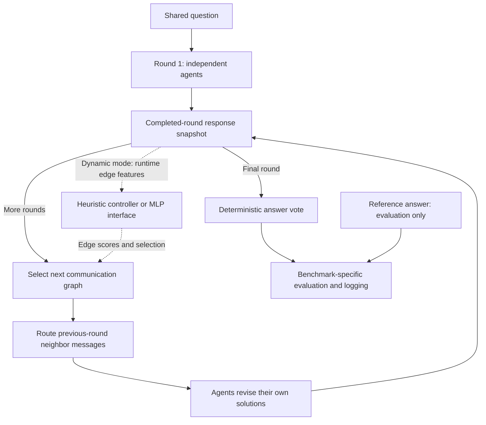

# Dynamic Multi-Agent Communication for LLM Reasoning

A research framework for studying **which LLM agents should communicate, and when**. Agents solve the same problem independently, exchange responses over a directed graph, and revise their answers across synchronized reasoning rounds. The proposed learned controller scores candidate communication edges so that the system can retain useful exchanges and reduce redundant context.

This CSE 585 project includes a working communication engine, fixed-topology baselines, a heuristic controller, benchmark-specific evaluation, and recorded Gemini experiments. **The MLP architecture and offline training interfaces are implemented, but the controller has not been trained and validated on genuine edge-utility labels. No dynamic-controller accuracy improvement has been demonstrated.**

## Motivation

Fully connected communication gives every agent access to every other agent's response. For N agents, this requires N(N − 1) directed edges per communication round. Repeated peer responses increase prompt length and token consumption, even when agents already agree.

A sparse graph reduces communication, but a fixed graph may omit a useful correction. This project investigates whether adapting edges from intermediate responses can improve the accuracy–communication tradeoff. The research question is whether a controller can identify helpful exchanges before seeing the reference answer—not simply whether fewer edges consume fewer tokens.

## System architecture

**Round 1 is independent reasoning.** Before each subsequent round, the system selects a graph and delivers messages from the completed previous round. An edge `A → B` means B receives A's previous response. Each agent also retains its own preceding response.

Inference currently executes sequentially, while completed-round snapshots enforce synchronized communication: an agent cannot see a neighbor's current-round answer. Graph updates affect the following reasoning round. The final responses are aggregated and then evaluated against benchmark references.



The agent and controller interfaces do not receive reference answers. Offline training labels may use ground truth, but runtime edge features may not.

### Communication topologies

| Mode | Behavior | Edges for four agents, without self-loops |
|---|---|---:|
| `fully_connected` | Every agent sends to every other agent | 12 |
| `ring` | Each agent sends to the next agent | 4 |
| `static_sparse` | Fixed edges supplied in YAML | Configurable; baseline config has 3 |
| `empty` | No peer messages; later rounds allow self-revision | 0 |
| `heuristic` | Recomputes edges from disagreement, consensus support and lexical redundancy | Selected between rounds |
| `mlp` | Scores all candidate directed edges using a PyTorch MLP | Requires a checkpoint with training/validation provenance |

Dynamic controllers evaluate absent edges as well as existing ones, allowing additions and removals. Agent IDs are `0..N-1`; invalid nodes and unconfigured self-loops are rejected. Round 1 has zero active communication edges regardless of the selected topology.

### Controller signals

The feature extractor produces 12 values per candidate edge, covering answer agreement, consensus agreement, changes in answer support, within-agent response similarity across rounds, and between-agent response similarity. Availability masks distinguish missing temporal information from observed zero change.

Answer support is a consensus-based confidence **proxy**, not calibrated model confidence. Similarity uses word-token Jaccard overlap, not semantic correctness. Temporal changes become available only after two completed rounds, so at least three reasoning rounds are needed for them to affect a topology decision.

## Key features and implementation status

| Capability | Current status |
|---|---|
| Synchronized multi-round reasoning and directed message routing | Implemented, covered by offline tests, and exercised in the real GSM8K pilot |
| Fixed graphs and heuristic dynamic selection | Implemented and tested; no reported real-LLM heuristic performance study |
| Modular LLM backend | OpenAI Responses and official Google Gen AI adapters; Gemini used in the recorded experiments |
| Offline mock backend | Deterministic apple-problem fixture for routing tests; not a benchmark reasoning model |
| Configurable agent roles | Step-by-step solver, alternative solver, critical reasoner and independent verifier; opt-in, with fixed role order |
| GSM8K and AQUA-RAT | Dataset loading, provenance, split separation and benchmark-specific evaluation |
| Reproducible experiment artifacts | JSONL traces, frozen question manifests, configuration/source hashes and package-version records in dedicated runners |
| Usage and failure accounting | Provider-reported tokens, request latency, graph/message traces and durable failure journals in dedicated pilot/diagnostic runners |
| MLP and offline training code | Configurable ReLU MLP, checkpointing, paired-label interface and supervised fitting; genuine training data and research validation remain future work |

GSM8K uses numerical exact match. AQUA-RAT uses five-choice option labels; v2 requires a final line such as `Final answer: B`. Voting selects the most frequent parsed answer (plurality): numeric ties choose the smallest numerical value, while option ties choose alphabetically. Missing or invalid answers abstain. References never determine the winning agent.

GSM8K training/validation partitions are formed before subset selection. AQUA-RAT retains its native train/validation/test partitions. The harder-question diagnostic freezes a question-text-only complexity selection; it does not select items based on which topology performs better. This proxy is not a validated measure of difficulty. MMLU, Multi-Arith, SVAMP and HumanEval evaluation are not implemented.

## Preliminary experimental results

Both studies below used the recorded model ID `gemini-3.5-flash-lite` with minimal thinking. These are small validation-set experiments, not final held-out evaluations.

### GSM8K: fixed-topology pilot

The same **10 frozen questions** were evaluated with four agents and three rounds per topology. Agents used generic reasoning prompts and a 512-token output cap. Round 1 was independent; communication occurred before rounds 2 and 3.

| Topology | Final accuracy | Input tokens | Output tokens | Edges in rounds 1 / 2 / 3 |
|---|---:|---:|---:|---|
| Fully connected | 10/10 (100%) | 75,200 | 22,498 | 0 / 12 / 12 |
| Ring | 10/10 (100%) | 44,002 | 22,175 | 0 / 4 / 4 |

The ring used **41.5% fewer input tokens**: `(75,200 − 44,002) / 75,200`. Both configurations were already correct after round 1, and no extracted agent answers changed across subsequent rounds. The pilot therefore showed a ceiling effect; it did not demonstrate communication-driven error correction or establish equivalent performance beyond these ten questions.

Token figures cover successful calls. The run required 240 successful responses and one additional HTTP 504 attempt, whose token usage is unknown. That timeout is excluded from the token comparison.

Source: [GSM8K pilot summary](results/gemini_10_question_pilot_summary.json).

### AQUA-RAT v2: independent-reasoning diagnostic

This was **not a communication-topology experiment**. Four role-specific agents answered the same harder-question cohort independently, with one round, zero edges and a 2,048-token output cap. Of 20 frozen validation questions, 16 completed, one was partial and three were not attempted; the run stopped after 66/80 generation attempts.

| Agent or aggregate | Correct on 16 completed questions | Accuracy |
|---|---:|---:|
| Step-by-step solver | 14/16 | 87.50% |
| Alternative solver | 14/16 | 87.50% |
| Critical reasoner | 15/16 | 93.75% |
| Independent verifier | 14/16 | 87.50% |
| System majority/plurality vote | 14/16 | 87.50% |

| Agreement diagnostic | Completed questions |
|---|---:|
| Agent disagreement | 3/16 (18.75%) |
| At least one label-correct and one label-incorrect agent | 3/16 (18.75%) |
| Unanimously label-correct | 13/16 (81.25%) |
| Unanimously label-incorrect | 0/16 |

Two system votes were tied 2–2; alphabetical tie-breaking matched the reference once and missed it once. The incomplete item is excluded from the 16-question accuracy denominator. Its second agent reached `MAX_TOKENS`; the backend rejected the truncated response and halted further requests.

**Answer-option/key consistency caveat:** the analysis flags questions whose stated arithmetic yields an answer absent from the displayed options, including the interrupted mixture question. Scores above retain the original benchmark labels, without rescoring or removing flagged items. They measure label agreement, not independently adjudicated mathematical correctness.

The AQUA-RAT and GSM8K results differ in dataset, prompts, roles, output limits, round count, sample size and completion. **They are not a controlled cross-dataset comparison and do not establish a benefit from communication or role diversity.**

Sources: [AQUA-RAT midterm report](results/aqua_v2_midterm.md) · [machine-readable analysis](results/aqua_v2_midterm.json).

## Installation and usage

### Environment setup

Use **Python 3.11+**. Dependencies are specified in [requirements.txt](requirements.txt): OpenAI and Google Gen AI SDKs, NetworkX, PyTorch, Hugging Face Datasets, NumPy, pandas, scikit-learn, python-dotenv, PyYAML, pytest and tiktoken. Version ranges are provided rather than an exact dependency lock.

From the repository root in Windows PowerShell:

```powershell
py -3.11 -m venv .venv
.\.venv\Scripts\Activate.ps1
python -m pip install -r requirements.txt
```

In VS Code, select `.venv\Scripts\python.exe` as the Python interpreter. If activation is unavailable, replace `python` in subsequent commands with `.\.venv\Scripts\python.exe`. On macOS/Linux, create the environment with `python3 -m venv .venv` and activate it with `source .venv/bin/activate`.

### Offline tests and topology demos

No API key is needed for these commands:

```powershell
# Skip the existing test that fits a synthetic MLP; run all other offline tests.
python -m pytest -q -k "not test_training_pipeline_and_leakage_guard"

# Four agents, two rounds, deterministic apple-problem fixture.
python -m experiments.run_baseline --backend mock --topology fully_connected --output results/demo_full.jsonl
python -m experiments.run_baseline --backend mock --topology ring --output results/demo_ring.jsonl
python -m experiments.run_baseline --backend mock --topology static_sparse --output results/demo_sparse.jsonl
python -m experiments.run_baseline --backend mock --topology empty --output results/demo_empty.jsonl

# Heuristic graph selection between three rounds.
python -m experiments.run_dynamic --backend mock --topology heuristic --rounds 3 --output results/demo_heuristic.jsonl

python -m experiments.summarize results/demo_full.jsonl results/demo_ring.jsonl
```

The mock supports only the supplied apple question. Its tokens are whitespace estimates and its latency is local execution time; neither represents API consumption or real reasoning. The baseline CLI appends JSONL, so use fresh output names to avoid mixing repetitions.

Offline coverage includes graph validation, routing, synchronized rounds, edge changes, feature masks, extraction/voting, reference isolation, mocked provider responses, approval guards and interrupted-run accounting. Passing these tests does not validate real-LLM reasoning or controller quality.

### API configuration

Create a local `.env` from [.env.example](.env.example) without replacing an existing file, then populate only the credentials needed for your backend:

```dotenv
OPENAI_API_KEY=
OPENAI_MODEL=
GEMINI_API_KEY=
GEMINI_MODEL=gemini-3.5-flash-lite
```

OpenAI needs a model available to your account via `OPENAI_MODEL` or configuration. For Gemini, the model in YAML takes precedence over the environment default. Never put real credentials in YAML, result files or version control. `.env` is ignored by [.gitignore](.gitignore).

| Configuration | Purpose |
|---|---|
| [baseline.yaml](configs/baseline.yaml) | Offline default; agent count, rounds, graph edges and controller thresholds |
| [gemini.yaml](configs/gemini.yaml) | Gemini 2.5 adapter configuration |
| [gemini_3_5_flash_lite.yaml](configs/gemini_3_5_flash_lite.yaml) | Model/settings used by the Gemini smoke and pilot tooling |
| [diverse_roles.yaml](configs/diverse_roles.yaml) | Four fixed reasoning strategies, mapped to nodes 0–3 |
| [diagnostic_aqua.yaml](configs/diagnostic_aqua.yaml) | Original independent diagnostic, 1,024-token cap |
| [diagnostic_aqua_v2.yaml](configs/diagnostic_aqua_v2.yaml) | Revised frozen-cohort diagnostic, concise final-option prompts and 2,048-token cap |

Roles are opt-in through `--roles-config configs/diverse_roles.yaml` on the baseline CLI. The v2 diagnostic selects its roles and prompt style through its configuration. Generic default agent behavior remains unchanged.

### Reproduce the recorded analysis without API calls

With the full local audit artifacts present, regenerate the AQUA-RAT tables and JSON under a new prefix:

```powershell
python -m experiments.analyze_diagnostic_v2 --output-prefix results/aqua_v2_midterm_reproduced
```

The analyzer recomputes choices and votes from returned text, reconciles call journals, checks stored evaluations and records source hashes. It refuses existing output names. It specifically analyzes the archived 66-request snapshot; a later continuation requires a separately reviewed analysis.

The full audit additionally requires three local-only files: `independent_diagnostic_aqua_v2_calls.jsonl`, `independent_diagnostic_aqua_v2_plan.json` and `independent_diagnostic_aqua_v2_state.json`, at their original paths in `results/`. These contain internal request/provenance metadata and are intentionally ignored by Git. The command therefore needs the preserved local artifact set; a public checkout alone is insufficient for full journal reconciliation. Public reports, summary metrics, original outcomes and frozen question/reference files remain available separately. No API request is made to recover missing artifacts.

### Live experiments and approval

**Verify current account access, model availability, billing status and remaining quota before requesting a live run. Use a fresh, plan-bound approval receipt for research experiments.** A historical YAML confirmation or old receipt is not a current account check.

The dedicated [diagnostic runner](experiments/run_diagnostic.py) separates preparation, local preflight, execution and reporting. Its local preflight makes no Gemini calls:

```powershell
python -m experiments.run_diagnostic preflight --config configs/diagnostic_aqua_v2.yaml
python -m experiments.run_diagnostic --help
```

A new diagnostic trial needs a separate configuration/output prefix, frozen question/reference manifests and a reviewed plan. The `run` action requires `--config` and `--approval-file`. The receipt must contain `approved`, `plan_sha256`, `free_tier`, `billing_disabled`, `remaining_daily_requests` and `checked_at`; approval and access flags must be true, the hash must match the exact plan, and the timezone-aware UTC confirmation must be less than one hour old.

For an 80-request diagnostic, at least **100 remaining daily requests** are required: 80 planned plus a 20-request reserve. The current diagnostic caps are 12 RPM, 200,000 conservative input TPM and at least 5.1 seconds between starts. Confirm that these fit the current project limits. Free-tier/billing and project-wide quota require an operator check in AI Studio; model metadata alone cannot attest them. The backend does not enable billing or select a paid fallback.

The archived v2 prefix already contains attempts. The runner intentionally refuses re-execution, overwrites and automatic replay. Do not delete existing logs to bypass these guards. Source, configuration, roles and data hashes are checked before live execution. Truncation, quota/authentication errors and unknown usage halt the diagnostic without mock substitution.

The lower-level `run_baseline` CLI does **not** enforce approval receipts; do not treat it as the guarded research-run interface. The dedicated OpenAI pilot has separate budget-approval tooling in [real_pilot.py](experiments/real_pilot.py). No live API command is part of the offline quick start.

## Repository structure

```text
dynamic-multi-agent/
├── README.md
├── requirements.txt
├── pytest.ini
├── configs/                    # Baselines, backend settings, roles and diagnostics
├── src/
│   ├── agents.py               # Prompts, response histories and reasoning roles
│   ├── runner.py               # Synchronized multi-round execution
│   ├── topology.py             # Directed graph construction and validation
│   ├── communication.py        # Previous-round message routing
│   ├── llm_client.py           # Backend protocol, OpenAI adapter and mock fixture
│   ├── gemini_client.py        # Gemini adapter, usage accounting and pacing
│   ├── features.py             # Candidate-edge features and availability masks
│   ├── controllers/            # Heuristic and MLP selection interfaces
│   ├── benchmarks.py           # GSM8K/AQUA-RAT loading and provenance
│   ├── evaluation.py           # Numeric/option extraction, voting and scoring
│   ├── roles.py                # Ordered role configuration
│   ├── difficulty.py           # Question-only complexity selection
│   ├── diagnostics.py          # Independent-agent agreement and error metrics
│   ├── training.py             # Offline paired labels and supervised fitting
│   └── pilot.py                # Shared pilot metering and logging helpers
├── experiments/                # Baseline/dynamic CLIs, guarded pilots, diagnostics,
│                               # recovery tools and offline analysis
├── tests/                      # Offline unit and regression tests
├── data/                       # Local dataset caches and frozen input artifacts
└── results/                    # JSONL traces, plans, summaries and reports
```

Dataset caches are local; the frozen GSM8K input `data/pilot_questions.jsonl` is explicitly allowlisted for reproducibility. For results, [.gitignore](.gitignore) uses an explicit allowlist for reviewed reports, summary metrics, original/canonical outcomes, frozen question/reference files and selected provenance records. Other results—including approvals, account-access confirmations, API journals, execution states and recovery bookkeeping—remain local and ignored. The README's result links target the public allowlist; allowlisting does not stage, commit or publish a file.

Use `gemini_10_question_pilot_final.jsonl` for the canonical 20 GSM8K question/topology outcomes. The original `gemini_10_question_pilot.jsonl` retains 37 historical snapshots/revisions and must not be averaged as 37 independent trials. Original AQUA-RAT v1 and v2 outcomes are retained separately, including incomplete/not-run statuses.

Historical artifacts bound by SHA-256 records retain their exact local bytes and paths. See the [cleanup and retention plan](docs/cleanup_plan.md) before deleting or relocating them, the [offline verification record](docs/cleanup_verification.md) for the cleanup checks, and the [staging review](docs/staging_review.md) for the subsequent public-file inventory. Keep credentials and access receipts private; review metadata before publishing additional artifacts.

## Research roadmap

1. **Study communication on harder questions.** Review benchmark option/key consistency, then compare peer communication against empty-graph self-revision with matched questions, roles, model settings and budgets.
2. **Collect genuine edge-utility labels.** Restore a frozen response snapshot and compare paired continuations with and without one candidate edge. Repeat interventions across training questions and context graphs; retain rollout traces and separate validation questions. Ground truth is permitted only for offline labeling/evaluation.
3. **Train and validate the MLP.** The current fitting target is whether adding an edge improves correctness; neutral and harmful outcomes share the nonpositive class. Assess label balance, variance, calibration and question-level generalization before interpreting predictions as useful edge scores.
4. **Compare learned, heuristic and fixed policies.** Evaluate accuracy, token usage, latency and active edges on held-out questions. Study edge interactions and broader benchmarks only after the single-edge methodology is established.

The paired-label and fitting code provides a starting point, not a completed data-collection study. Edge utility depends on the surrounding graph and other agents' behavior; interacting edges complicate attribution. A checkpoint's provenance flag is a software guard, not evidence of scientific validity.

## Limitations

- **Small, preliminary samples:** ten GSM8K questions per topology and sixteen completed AQUA-RAT questions do not establish general performance or statistical superiority.
- **Initial ceiling effect:** GSM8K votes were correct before communication, leaving no observed accuracy errors for later rounds to correct.
- **Incomplete AQUA-RAT execution:** output truncation stopped both diagnostic versions; the v2 150-word instruction is not a hard generation-length constraint. Completed-prefix analysis may be biased.
- **Benchmark quality:** reported answer-option/key inconsistencies require review. Current accuracy remains agreement with the supplied reference labels.
- **No demonstrated learned-controller benefit:** no MLP has been trained and validated on genuine edge-utility data, and no dynamic-controller accuracy improvement has been shown.
- **Approximate controller signals:** lexical similarity and consensus support can reflect shared mistakes; diverse role prompts do not guarantee independent errors.
- **Reproducibility and latency:** frozen inputs and recorded settings do not guarantee identical hosted-model responses. Execution is sequential, and request latency differs from wall time including pacing.
- **Evaluation scope:** only GSM8K and AQUA-RAT evaluators are implemented. Numerical/option exact match does not provide code-generation evaluation or support unimplemented benchmarks.
